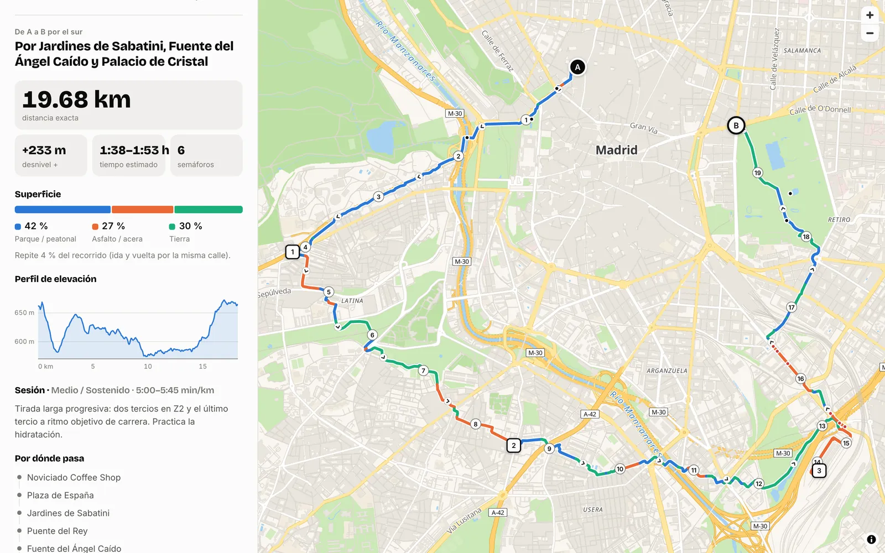
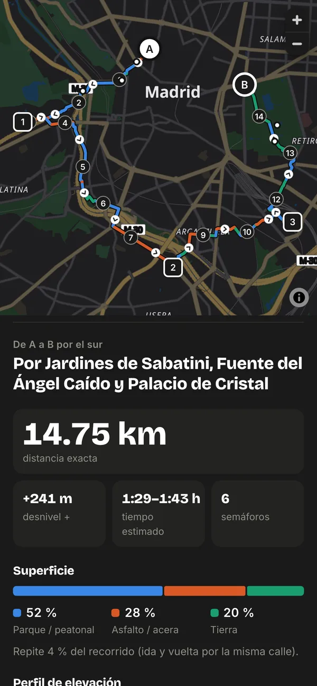
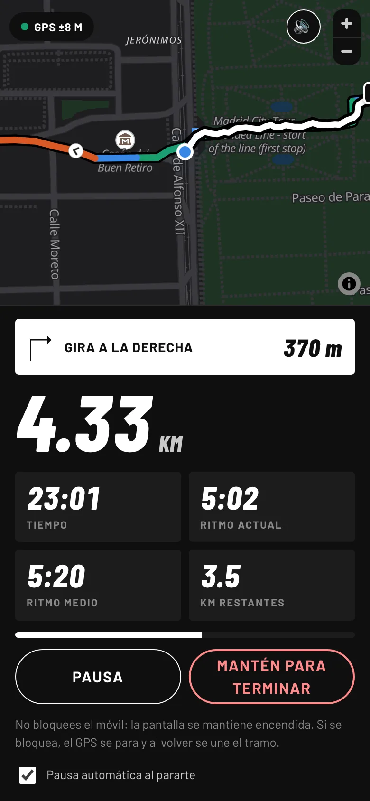

# Rutas A→B

Generador de rutas para salir a correr. Eliges desde dónde sales, a dónde quieres llegar y cuántos
kilómetros te apetecen (hasta 42), y la app se inventa una ruta real entre los dos puntos,
intentando meterte por parques y paseos peatonales. Si no pones llegada, te hace un bucle. Luego
puedes correrla con la propia app: te sigue con el GPS, te dice el ritmo y te avisa de los giros.

**Pruébala aquí: https://danielcs94.github.io/rutas-ab/**

<p>
  
  
</p>
<p>
  
</p>

Empezó como [Rutas Noviciado](https://github.com/danielcs94/rutas-noviciado), que solo hacía bucles
de hasta 10 km saliendo de una cafetería de Malasaña. Funcionaba bien, pero estaba atada a ese sitio:
todos los datos de calles y desnivel estaban precalculados para unos pocos kilómetros a la redonda.
Esta versión funciona desde cualquier punto y para cualquier distancia razonable.

## Qué hace

- Funciona en cualquier ciudad del mundo. Buscas la salida y la llegada por dirección, las marcas
  tocando el mapa o usas tu ubicación. La primera vez, el mapa se abre en tu ciudad (la saca de la
  zona horaria y del idioma del navegador, sin pedir permisos).
- Le pides una distancia. Antes de nada mide el camino más corto entre los dos puntos y, si pides menos
  que eso, te dice cuál es el mínimo.
- Cada vez que le das al botón sale una ruta distinta. Calcula cuatro y te enseña la que mejor encaja
  con la intensidad que hayas elegido. Las otras quedan como alternativas.
- De cada ruta te dice la distancia exacta, el desnivel con su perfil, cuánta parte es parque, asfalto
  o tierra, los semáforos, el tiempo estimado y una sesión de entrenamiento que cambia si es una tirada
  larga.
- La puedes abrir en Google Maps o descargar en GPX para Strava, Garmin o Komoot.
- O correrla desde la app con el modo carrera (más abajo), que guarda cada carrera en "Mis carreras".
- Se instala en el móvil como una app, con un estilo deportivo (titulares condensados en cursiva, blanco
  y negro y acento neón) en modo claro y oscuro.

## Cómo se inventa la ruta

La idea central es una elipse con A y B como focos. En una elipse, la suma de las distancias de
cualquier punto a los dos focos es siempre la misma. Así que cualquier camino que vaya de A a un punto
de la elipse y de ahí a B mide lo mismo en línea recta, y el tamaño de la elipse decide cuánto se alarga
la ruta.

Sobre esa elipse coloco 2 o 3 puntos de paso al azar, a un lado o al otro del camino directo, y le pido
a [Valhalla](https://github.com/valhalla/valhalla) la ruta a pie que pasa por ellos. La distancia que
sale nunca es la pedida a la primera, así que el tamaño de la elipse se corrige con el método de la
secante. Con tres o cuatro intentos queda justo por debajo de los kilómetros que querías.

La elipse tiene un problema: sus puntos siempre quedan lejos del camino directo, así que las rutas
rodean la ciudad por fuera. Para ir por en medio hay una segunda forma, en zigzag: los puntos de paso
van a lo largo de la línea entre A y B, alternando a un lado y a otro, y lo que se ajusta es cuánto se
separan. Con el control "Por dónde" eliges: **Parques** (solo elipses, que buscan zonas verdes),
**Ciudad** (solo zigzag, sin penalizar asfalto ni semáforos) o **Mezcla** (de las dos). De Plaza de
Castilla a Príncipe de Vergara, por ejemplo, las rutas en zigzag no se alejan más de un kilómetro del
camino directo, mientras que las elipses daban rodeos de hasta dos kilómetros y medio.

Si A y B son el mismo punto, la elipse se convierte en un círculo que pasa por A y la ruta es un bucle.

## Modo carrera

Con el botón "Empezar carrera" la app pasa a pantalla completa y usa el GPS del móvil:

- Distancia, tiempo, ritmo actual (de los últimos 20 segundos), ritmo medio y kilómetros que faltan.
- El mapa te sigue y pinta lo que llevas recorrido encima de la ruta.
- Te avisa por voz de los giros ("en 60 metros, gira a la derecha"), de cada kilómetro con su ritmo
  y de si te sales de la ruta, diciéndote hacia dónde queda.
- Se pausa sola cuando te paras en un semáforo y sigue cuando vuelves a correr.
- Para terminar hay que mantener el botón pulsado un segundo, para no cortarla sin querer.
- Al acabar te enseña el resumen con los parciales por kilómetro y puedes compartir o descargar el GPX
  de lo que has corrido de verdad, con la hora de cada punto, para subirlo a Strava.
- Si se recarga la página a mitad de carrera, la recupera en pausa.
- Al empezar en el móvil, una ventana explica cómo bloquear los toques para llevarlo en el bolsillo o
  el brazalete: en iPhone con el Acceso guiado y en Android con "Fijar aplicación" o la protección
  contra toques accidentales que traen muchos móviles. Se puede marcar para que no salga más.

Lo difícil fue que la distancia saliera bien. El GPS del móvil baila unos metros en cada lectura, y si
sumas la distancia entre lecturas sale bastante más de lo que has corrido. Probé primero con un filtro
de Kalman sencillo, que mezcla cada posición con la anterior según su precisión. Con buena señal
funcionaba, pero con mala señal recortaba las esquinas y se perdía hasta un 30 % en rutas con muchos
giros. La solución fue aprovechar que ya tenemos la ruta: mientras vas por ella, la distancia es lo que
avanzas sobre la ruta, y el GPS solo cuenta cuando te sales. Lo probé con carreras simuladas con ruido
y queda por debajo del 1 % de error con buena señal y alrededor del 3 % con muy mala.

La lógica está separada de la pantalla (`tracker.js`) para poder probarla así, sin salir a correr.

## De dónde salen los datos

Todo sale en directo de servicios abiertos de OpenStreetMap. No hay backend ni APIs de pago:

- Las rutas a pie, de Valhalla, con preferencia por paseos peatonales y caminos de tierra. Con la
  intensidad "Avanzado" además busca cuestas.
- El desnivel, del endpoint `height` de Valhalla.
- El tipo de cada tramo (calle, sendero, tierra) y los semáforos, de `trace_attributes`.
- Las direcciones, de Nominatim, en el idioma del navegador.
- Los nombres de las rutas salen de las calles y paseos por los que pasa cada tramo, así que valen en
  cualquier ciudad: "Por 9 de Julio, Misiones y 2 km de parque" en Córdoba (Argentina) o el paseo del
  río Sumida en Tokio. En Madrid, además, se usan lugares conocidos como el Retiro o Madrid Río.
- El mapa es vectorial, con MapLibre y teselas de OpenFreeMap, recoloreado para parecerse a Apple Maps.

## Problemas que me encontré

En una ruta de 42 km el trazado codificado ocupa decenas de miles de caracteres y no cabe en la URL de
una petición GET. Lo mando por POST con `Content-Type: text/plain`, que el navegador trata como una
petición simple: no necesita la consulta previa de CORS y no tiene límite de tamaño.

Algunos puntos al azar caen en sitios sin acceso a pie, como un recinto cerrado o el otro lado de una
autovía, y el router no encuentra ruta. Le pido que solo enganche puntos a calles bien conectadas
(`minimum_reachability`). Si aun así falla, prueba con OSRM o descarta esa ruta, y siguen quedando las
otras tres.

El servidor público de Valhalla solo acepta 10 puntos por petición. Las listas largas se parten en
trozos que comparten el punto de unión y luego se pegan.

Una web no puede seguir usando el GPS con la pantalla bloqueada. Durante la carrera la app pide al
navegador que no apague la pantalla y, si aun así se bloquea, al volver une el tramo perdido siguiendo
la ruta en vez de con una línea recta. Quedaba el problema de llevar el móvil encendido en el bolsillo
sin pulsar nada. Eso no se puede resolver desde una web, pero el iPhone tiene el Acceso guiado, que
desactiva los toques en toda la pantalla, así que la app te enseña a usarlo justo antes de empezar.

Y uno que ya me pasó con la primera versión: en el móvil, la caché del navegador mezclaba archivos
viejos y nuevos y la app se rompía. `tools/release.py` pone un número de versión a todos los módulos
antes de cada publicación.

## Ejecutarla en local

```bash
python3 tools/serve.py 5182
```

Y abrir http://localhost:5182. No hay que instalar nada. Antes de subir cambios:

```bash
python3 tools/release.py
```

## Archivos

```
js/
  planner.js     la elipse, la calibración de la distancia y la puntuación de cada ruta
  api.js         Valhalla (rutas, altitud y atributos), OSRM de reserva y Nominatim
  app.js         la interfaz: puntos A y B, controles, resultado e historial
  run.js         el modo carrera: pantalla, GPS, voz y mis carreras
  tracker.js     las cuentas de la carrera: distancia, ritmos, parciales, giros y desvíos
  map.js         el mapa y lo que se dibuja encima
  mapstyle.js    la paleta tipo Apple Maps
  profile.js     el perfil de elevación
  config.js      límites, intensidades y lugares conocidos de Madrid
tools/
  serve.py       servidor local sin caché
  release.py     versiona los archivos antes de publicar
```

## Límites

- Una ruta larga tarda entre 20 y 30 segundos, porque los servidores gratuitos no dejan hacer muchas
  peticiones seguidas.
- La distancia final queda entre un 90 % y un 100 % de la pedida.
- El enlace de Google Maps lleva 9 puntos repartidos por la ruta, el máximo que admite Google, para que la
  siga casi igual. Abierto en el navegador del móvil (y no en la app), Google solo usa 3. La ruta exacta
  está siempre en el GPX.
- Los caminos de los parques casi nunca tienen nombre en OpenStreetMap, así que fuera de Madrid el
  nombre de la ruta dice "X km de parque" en vez del nombre del parque.
- El modo carrera necesita la pantalla encendida: si se bloquea, el GPS se para hasta que vuelves. Con
  el Acceso guiado del iPhone se puede llevar encendida sin que se pulse nada.
- Una web no tiene acceso a Salud de Apple ni a Health Connect de Android. Para guardar ahí una carrera
  hay que pasar el GPX por una app que sí lo tenga, como Strava.
- La interfaz está en español.

## Créditos

Datos © colaboradores de OpenStreetMap (ODbL). Rutas, altitud y atributos con Valhalla y OSRM de
FOSSGIS. Búsqueda con Nominatim. Mapa de OpenFreeMap.
